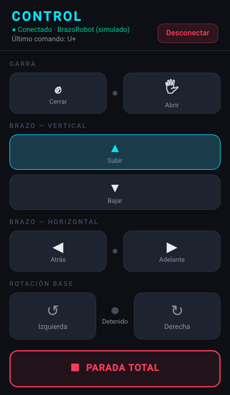

# BrazoRobot

**Español** · [English](#english)

Brazo robótico de 4 ejes controlado desde un teléfono Android por Bluetooth. Incluye el firmware para ESP32, la app (React Native + Expo) y una guía para armarlo con piezas baratas y fáciles de conseguir.



**Qué hace**

- Abre y cierra la garra, sube y baja el brazo, lo mueve adelante y atrás, y gira la base.
- Cada eje se mueve mientras mantienes presionado su botón y se detiene al soltarlo.
- Parada total con un botón, y parada automática si se corta el Bluetooth.
- Modo simulado en el navegador para probar la app sin robot.

**Hardware**

| | |
|---|---|
| Controlador | ESP32 DevKit (WROOM-32) |
| Garra, brazo vertical, brazo horizontal | 3 servos SG90 |
| Base giratoria | Motor paso a paso 28BYJ-48 + driver ULN2003 |
| Estructura | Kit de brazo de MDF/acrílico para SG90 |
| Alimentación | Fuente de 5 V, 2 A |

<br clear="right">

## Empezar

1. **Arma y conecta** el hardware siguiendo la [guía de armado](docs/armado.md), que incluye lista de materiales, diagrama de conexiones y calibración.
2. **Carga el firmware** `firmware/brazo_robot/brazo_robot.ino` en el ESP32 con Arduino IDE o `arduino-cli` (core de Espressif 3.x).
3. **Instala la app** en tu Android:

   ```bash
   cd app
   npm install
   npm run android      # build nativo; no funciona en Expo Go
   ```

4. Empareja **BrazoRobot** en los ajustes de Bluetooth del teléfono, abre la app y conéctate.

Para ver la app sin teléfono ni robot: `cd app && npm install && npm run web`.

## Estructura

```text
app/                    App Android (React Native + Expo)
  App.js                Pantallas de búsqueda y control
  src/bluetooth.*.js    Bluetooth real (Android) y simulado (web)
firmware/brazo_robot/   Sketch del ESP32
docs/armado.md          Guía de armado, calibración y protocolo
scripts/make_icons.py   Genera los íconos de la app
```

## Protocolo

La app y el ESP32 se comunican con líneas de texto: `G±` garra, `U±` vertical, `F±` horizontal, `R±` base, `R` detener la base, `S` detener todo. Detalles en la [guía](docs/armado.md#protocolo).

## Licencia

[MIT](LICENSE)

---

## English

A 4-axis robotic arm controlled from an Android phone over Bluetooth. The repository contains the ESP32 firmware, the app (React Native + Expo) and a build guide using cheap, widely available parts.

- **Hardware:** ESP32 DevKit (WROOM-32), three SG90 servos (gripper, vertical and horizontal arm), a 28BYJ-48 stepper with ULN2003 driver for the rotating base, an MDF/acrylic SG90 arm kit and a 5 V 2 A power supply.
- **Firmware:** `firmware/brazo_robot/brazo_robot.ino`, built with the Espressif Arduino core 3.x. Axes move while a button is held and stop on release or when Bluetooth drops.
- **App:** `cd app && npm install && npm run android` (native build, not Expo Go). `npm run web` opens a simulated arm in the browser.
- **Wiring, calibration and protocol:** see [docs/armado.md](docs/armado.md) (Spanish). The wiring diagram is in [docs/conexiones.svg](docs/conexiones.svg).

Note: the ESP32 must support Bluetooth Classic (SPP). ESP32-S2, S3, C3 and C6 boards are BLE-only and will not work.

Licensed under the [MIT License](LICENSE).
