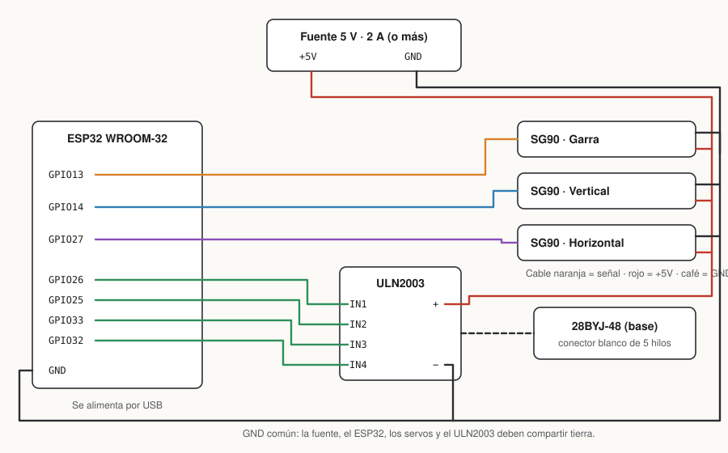

# Guía de armado

Esta guía cubre la electrónica, el firmware y la app. La estructura mecánica sale de un kit de brazo de 4 ejes para servos SG90 (MDF o acrílico, del estilo del MeArm), que se consigue en tiendas de electrónica y en línea.

## 1. Materiales

| Cant. | Pieza | Notas |
|---|---|---|
| 1 | Kit de brazo robótico de MDF/acrílico para SG90 | Incluye tornillería; elige uno con base giratoria |
| 1 | ESP32 DevKit (WROOM-32) | **Tiene que ser ESP32 "clásico"**: S2, S3, C3 y C6 no tienen Bluetooth Clásico |
| 3 | Servo SG90 | Garra, brazo vertical y brazo horizontal. Los MG90S (engranes metálicos) son compatibles |
| 1 | Motor paso a paso 28BYJ-48 (5 V) + placa ULN2003 | Gira la base |
| 1 | Fuente de 5 V y al menos 2 A | Eliminador de 5 V, módulo de carga USB o 4 pilas AA recargables |
| — | Cables dupont macho-hembra, protoboard | Una protoboard pequeña basta para repartir 5 V y GND |
| 1 | Teléfono Android 7.0 o superior | Para la app |

> **No alimentes los servos desde el pin de 5 V del ESP32.** Al moverse, tres SG90 pueden pedir más de 1 A y el ESP32 se reinicia o se desconecta del Bluetooth. Usa la fuente externa y une las tierras.

## 2. Conexiones



| Componente | Pin del componente | Va a |
|---|---|---|
| Servo garra | señal (naranja) | GPIO 13 |
| Servo vertical | señal (naranja) | GPIO 14 |
| Servo horizontal | señal (naranja) | GPIO 27 |
| Los 3 servos | rojo / café | +5 V / GND de la fuente |
| ULN2003 | IN1, IN2, IN3, IN4 | GPIO 26, 25, 33, 32 |
| ULN2003 | + / − | +5 V / GND de la fuente |
| 28BYJ-48 | conector blanco | conector de la placa ULN2003 |
| ESP32 | GND | GND de la fuente (**tierra común**) |
| ESP32 | USB | computadora o cargador |

Los pines están definidos al inicio de `firmware/brazo_robot/brazo_robot.ino`; si cambias alguno, evita los GPIO 0, 2, 5, 12 y 15, que el ESP32 usa al arrancar.

## 3. Cargar el firmware

### Con Arduino IDE

1. En **Preferencias → URLs adicionales de gestor de tarjetas** agrega
   `https://espressif.github.io/arduino-esp32/package_esp32_index.json`.
2. En **Gestor de tarjetas** instala **esp32 de Espressif**, versión 3.x.
3. Abre `firmware/brazo_robot/brazo_robot.ino`.
4. Elige la placa **ESP32 Dev Module** y el puerto del ESP32.
5. Pulsa **Subir**. Si se queda en `Connecting...`, mantén presionado el botón **BOOT** del ESP32 hasta que empiece a escribir.

### Con arduino-cli

```bash
arduino-cli core install esp32:esp32
arduino-cli compile --fqbn esp32:esp32:esp32 firmware/brazo_robot
arduino-cli upload  --fqbn esp32:esp32:esp32 -p /dev/ttyUSB0 firmware/brazo_robot
arduino-cli monitor -p /dev/ttyUSB0 -c baudrate=115200
```

En el monitor serie debe aparecer `Listo. Empareja el teléfono con "BrazoRobot".`

> La librería `BluetoothSerial` viene con el core 3.x de Espressif. Espressif anunció que dejará de incluirla por defecto en la versión 4.0; si usas esa versión, instala el core 3.3.x.

## 4. Calibrar antes de atornillar

Los servos SG90 solo giran 180° y se dañan si la estructura los frena. Por eso:

1. Con el ESP32 encendido y los servos conectados **pero sin montar**, deja que vayan a su posición inicial (garra 60°, brazos 90°).
2. Coloca los brazos de plástico (horns) en esa posición y monta el kit siguiendo su instructivo.
3. Prueba cada eje desde la app. Si un servo **zumba** al llegar a un extremo, está forzando: reduce `maxDeg` o sube `minDeg` de ese eje en el arreglo `axes[]`.
4. Si un botón mueve el eje al revés, cambia su signo en `AXIS_SIGN`.

| Ajuste | Dónde | Para qué |
|---|---|---|
| `minDeg`, `maxDeg`, `homeDeg` | `axes[]` | Límites y posición inicial de cada servo |
| `AXIS_SIGN` | arriba del sketch | Invertir la dirección de un eje |
| `SERVO_SPEED_DEG_S` | arriba del sketch | Velocidad al mantener presionado (60°/s por defecto) |
| `STEP_INTERVAL_US` | arriba del sketch | Velocidad de la base; menos de ~900 µs y el 28BYJ-48 pierde pasos |

## 5. Instalar la app

La app usa Bluetooth Clásico, así que necesita un build nativo; **no funciona en Expo Go**.

Requisitos: Node.js 20+, Android Studio (instala el SDK y el JDK) y el teléfono con **depuración USB** activada.

```bash
cd app
npm install
npm run android        # compila e instala en el teléfono conectado por USB
```

Para ver la interfaz sin teléfono ni robot: `npm run web`. En el navegador aparece un **BrazoRobot (simulado)** que muestra el último comando enviado.

## 6. Usarlo

1. Enciende la fuente y el ESP32.
2. En el teléfono, **Ajustes → Bluetooth**, empareja **BrazoRobot**. Si pide PIN, prueba `1234` o `0000`.
3. Abre la app, pulsa **Buscar dispositivos** y elige BrazoRobot.
4. Mantén presionado un botón para mover ese eje; al soltarlo se detiene. **Parada total** detiene todo.

Si se corta el Bluetooth, el firmware detiene todos los motores.

## Protocolo

La app manda una línea de texto por comando. Puedes probarlo desde cualquier terminal serie Bluetooth (por ejemplo *Serial Bluetooth Terminal* en Android).

| Comando | Acción |
|---|---|
| `G+` / `G-` | Abrir / cerrar la garra |
| `U+` / `U-` | Subir / bajar el brazo |
| `F+` / `F-` | Brazo adelante / atrás |
| `R+` / `R-` | Girar la base a la derecha / izquierda |
| `R` | Detener la base |
| `S` | Detener todo |

## Problemas comunes

| Síntoma | Causa probable |
|---|---|
| El ESP32 se reinicia al mover un servo | Servos alimentados desde el ESP32 o fuente débil. Usa la fuente externa de 2 A |
| Los servos tiemblan o se mueven solos | Falta la tierra común entre la fuente y el ESP32 |
| BrazoRobot no aparece en la app | Primero hay que emparejarlo en los ajustes de Bluetooth del teléfono |
| El sketch no compila: "no tiene Bluetooth Clásico" | La placa elegida es un S3, C3 u otro modelo sin SPP |
| La base vibra pero no gira | Un cable IN1–IN4 en otro orden, o `STEP_INTERVAL_US` demasiado bajo |
| Un servo zumba y se calienta | Está forzando contra la estructura; ajusta sus límites |
